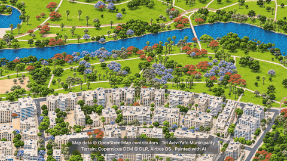

# Isometric World

Isometric maps of real cities, built from open data. Everything is TypeScript.



First city: **Tel Aviv-Yafo** (`/tel-aviv-yafo` on the dev server), from Jaffa to Yarkon Park and
Ramat Gan, including the sea. Full-quality clip: [`video/tel-aviv-yafo.mp4`](video/tel-aviv-yafo.mp4).

Second region: **Shanghai** (`/shanghai`), central Shanghai from Jing'an across the Bund and Lujiazui to
the North Bund (about 8.4 × 9.3 km). It is built from OpenStreetMap and Copernicus DEM alone and rendered as
a **cel-shaded cartoon** (`render --style cartoon`: flat posterised colour, ink outlines from the depth pass,
watercolour paper grain), so no image-model painting step is involved.

Third region: **Chengdu · Longquanyi** (`/longquanyi`), the 成都经开区 strip from 大面 through the development
zone to the 龙泉驿 district town, built from OpenStreetMap and Copernicus DEM and rendered with the same
cel-shaded cartoon (terrain here is ~480 m, so the region carries a `groundH`/`groundU` for projections and
batching). Its page has the search box and a literary description too.

The Shanghai page adds eight **hand-modelled landmarks** (`pipeline/src/landmarks.ts` + procedural three.js
models in `pipeline/page/renderer.ts`): the Oriental Pearl at its real 468 m with 50/45 m spheres, Shanghai
Tower, SWFC, Jin Mao, the Customs House, HSBC Tower, Huxinting and the Shanghai Museum; their OSM footprints
are replaced by the models. A **search box** (`/` to focus) flies to any landmark or neighbourhood, the
bottom-right card carries a literary description (`description` in `places.ts`), and **全市域** opens a
whole-municipality card generated from OSM district boundaries/water and the Copernicus DEM land mask by
`pipeline/src/citymap.ts` (`web/public/city/shanghai-overview.png`).

## The idea

Real cities as a hand-painted isometric illustration you can pan and zoom like a map, with every building,
street and tree where it really is, and a little life on top (cars, buses, cats, parakeets, an airliner).

1. **Geometry from open data**: buildings and trees (municipal GIS, OpenStreetMap), streets, parks,
   coastline (OpenStreetMap), terrain (Copernicus DEM). No Google or other proprietary map content.
2. **One orthographic camera per region** (45° tilt, 0.25 m/px) renders it as a plain 3D model with three.js.
3. **An image model repaints every window** of that render in one illustrated style, checked against the
   render so nothing moves.
4. **A deep-zoom web viewer** (Astro + OpenSeadragon) streams the painted tiles from Cloudflare R2 and draws
   the simulated traffic on top.

## Quick start

Needs Node 24+, Chromium (or Chrome: set `CHROME_PATH`), and for the optional steps FFmpeg (clips), gifsicle (GIF), the Codex CLI
(painting) and a Cloudflare account with wrangler (publishing).

```sh
npm install
npm run dev        # open http://localhost:<port>/tel-aviv-yafo (port printed by the dev server): the published map, from R2
```

Building the map yourself starts at **Pipeline** below; no API keys are needed except your own Cloudflare
login for publishing (`.env.example`).

**Adding a city** (for people and coding agents): see [AGENTS.md](AGENTS.md): what to research, which open
datasets and licences are acceptable, code changes, pipeline commands and checks. Sources and credit lines:
[ATTRIBUTION.md](ATTRIBUTION.md).

## Regions and cities

`pipeline/src/places.ts` is the one table of places, shared by the pipeline and the site.

- A **region** is one flat map: one orthographic camera in a local East-North-Up frame at the region's
  origin, one tile pyramid under `regions/<region>/` on R2 (see Hosting). A flat map stays accurate (~1° of building lean
  at 100 km) for every city within ~150 km of its origin, so they share it and you scroll between them.
  Far-apart cities get their own region (a world overview linking regions can come later).
- A **city** is a named view into a region. `/<city>` (e.g. `/tel-aviv-yafo`) opens the region centred on it;
  `/` opens the default city. Links with capitals (`/Tel-Aviv-Yafo`) redirect to the lowercase one (404 page).
- An **area** (`pipeline/src/areas.ts`) is a bbox the pipeline renders and paints; it belongs to a region,
  and every step switches to that region's camera (`openArea` → `useRegion`).

Links: `/tel-aviv-yafo?at=32.054,34.752,1` (lat, lon, screen width in km), `#@x,y,zoom` (kept in the URL
while you pan), `#metro` (whole region).

## Hosting

**Site:** Cloudflare Workers static assets (`wrangler.jsonc`).
Build `npm run build`, deploy `npm run deploy` (builds, then `wrangler deploy` on `SITE_DOMAIN` from `.env`).
Only the built pages go there.

**Analytics:** Pirsch (cookie-free), proxied first-party by the site's Worker (`worker/index.ts`, only
`/p/*`; snippet in `web/src/components/MapPage.astro`, production builds only). Set the access key once
(Pirsch → Settings → Integration → Add Client, type "Access Key"): `npx wrangler secret put PIRSCH_ACCESS_KEY`.

### Map data (R2)

Map data is not in git or `web/public`. It lives in the R2 bucket `isometricworldtiles` (Cloudflare account
`CLOUDFLARE_ACCOUNT_ID`), served under `regions/<region>/` from its public origin `TILES_ORIGIN` (`.env`,
see `.env.example`; read by `pipeline/src/hosting.ts`).

```
data/derived/<area>/{render,paint,height}   sources (local only; expensive: back them up)
        │ npm run export -- <areas>          only tiles whose source changed (state: data/web-state/<region>.json)
        ▼
data/web/regions/<region>/                  local cache = unpublished changes
        │ npm run dev                        dev server serves the cache, redirects everything else to R2
        │ npm run publish -- <region>        upload (asks [y/N]), check, record state, empty the cache
        ▼
R2 isometricworldtiles/regions/<region>/    production (dev and deployed builds read it)
        │ npm run deploy                     rebuild the site: pages pick up the new file names and previews
```

- **Deploy after every publish.** Each page is built with the published `world.json`: it preloads the
  content-hashed files named there and shows the city preview from it. Without a redeploy the site still
  works (the viewer reads the live `world.json`), but the preloads miss and the preview shows the old view.

- Everything but `data/world.json` is cached for a year (`immutable`): tile URLs carry `?v=<content hash>`
  from `tiles-<layer>.<hash>.json`, and the data files and city previews have their hash in the name, so a
  re-painted tile or a new export gets new URLs. `world.json` (60 s) names the current files; the page
  preloads the ones its build saw. Tiles are AVIF; the last WebP pyramid (`tiles.json`, `.webp`) stays as
  the fallback for browsers without AVIF.
- Export works without the cache: lower zoom levels that need an unchanged neighbour fetch it from R2.
  Exports stack until you publish (`data/web/<region>.state.json`); deleting `data/web/` drops unpublished
  work and nothing else. Deleting `data/web-state/<region>.json` makes the next export rebuild everything.
- Publish uses the wrangler login (`npx wrangler login`) or `CLOUDFLARE_API_TOKEN`. The Cloudflare API allows
  ~4 uploads/s: a whole region (~9k files) takes ~40 min once; later publishes carry only changes.
  `--keep` leaves the cache in place, `--yes` skips the question.
- The bucket is public, read-only (CORS: any origin, GET/HEAD), so a production build works from any host or
  local port. In dev, `/regions/*` goes through the dev server: the local cache first, then proxied from R2.

## Pipeline

```sh
npm install

npm run fetch -- tlv-core              # municipal + OSM buildings, canopy, OSM ground, Copernicus DEM
npm run ground -- tlv-core             # terrain grid + OSM ground features (ENU)
npm run scene -- tlv-core              # 3D buildings + trees (ENU) binned by render tile
npm run render -- tlv-core -j 2        # open-data scene -> one ortho camera -> tiles (~0.2 s/tile)
npm run paint -- tlv-core --near 32.064,34.775 --radius 2   # Codex repaint (optional, slow)
npm run export -- rothschild tlv-core  # changed web tiles + data into the local cache (all areas of one region)
npm run dev                            # preview: local cache over production tiles
npm run publish -- israel-center       # upload the cache to R2 (asks first), then empty it
npm run dev                            # Astro + OpenSeadragon viewer
pipeline/watch-export.sh &             # re-export every 20 min while painting (preview in dev; publish when happy)

# tests and clips (against a running site; the URL argument can be left out when SITE_URL is set in .env)
npm -w pipeline exec tsx src/uitest.ts http://localhost:<port>/   # wheel/drag/keys, errors, screenshots
npm -w pipeline exec tsx src/perf.ts   http://localhost:<port>/   # bytes & time per zoom step
npm -w pipeline exec tsx src/tour.ts   http://localhost:<port>/ tour   # screenshots of known places
npm -w pipeline exec tsx src/traffictest.ts http://localhost:<port>/ 5     # 5 sim-minutes: overlaps, speeds, jams
npm -w pipeline exec tsx src/film.ts http://localhost:<port>/ ../video/tel-aviv-yafo.mp4  # 14 s 1080² 60 fps clip for X (--preview: quick 6 fps check; --blur 8: motion blur)
```

| Step | File | What it does |
|---|---|---|
| camera | `pipeline/src/camera.ts` | One orthographic camera per region, tilted 45° down, 0.25 m/px, in a local ENU frame at the region origin (Israel Center: Dizengoff Square, heading 340°). The same math drives both the renderer and the border projection, so they align exactly. |
| fetch / scene | `pipeline/src/fetch.ts`, `scene.ts` | Buildings come from Tel Aviv-Yafo GIS (footprints + 2019 surveyed heights) and OSM elsewhere, and trees from the 2024 canopy layer, all extruded in our renderer. |
| ground | `pipeline/src/ground.ts`, `pipeline/page/ground.ts` | Terrain from Copernicus GLO-30 (a surface model: buildings removed with a morphological opening + blur), sea from the OSM coastline. The surface is drawn per tile from OSM onto a canvas texture draped on the terrain: landuse, parks, beach, water, pavements, roads at real widths (`roadspec.ts`, shared with traffic) with lane markings kept out of junctions, flat road ends with junction disks (no bulges at bridge ends), rail drawn in its layer (under road bridges), zebra crossings, paths, rail, soft contact shadows. Bridges/decks the municipal layer records as buildings (anything a motorway or railway runs through) are dropped in `scene.ts`. |
| render | `pipeline/src/render.ts`, `pipeline/page/renderer.ts` | Headless Chrome (Playwright) + three.js. Buildings sit on the terrain grid and get window-grid facades; tree crowns are instanced. Each tile gets a color pass and a height pass. No network access, no API keys. `--style cartoon` renders through a depth target and a fullscreen pass that posterises the shading, inks silhouettes and roof creases, and lays paper grain keyed on global pixel coordinates (so tiles join seamlessly); it is the default for Shanghai and Chengdu. |
| paint | `pipeline/src/paint.ts` | Codex CLI image generation (ChatGPT login, no API key). Each window gets four images: the render, the height map, the style reference (`pipeline/style/reference.png`) and the tree species sheet (`pipeline/style/trees.png`: ficus, tipuana, jacaranda, flame tree, olive, Aleppo pine, eucalyptus, date and fan palms; the render colour-codes each crown's species, mostly one species per ~40 m patch). Windows are 1024 px with stride 896, painted in rings from the centre; each continues its painted neighbours. Open sea reuses one validated sea texture. Any window with a black band or patch is repainted, and every restart re-checks finished windows. Negative window numbers need `--window=-7,4`. To fix something on a seam, delete the neighbour sharing it first (each window copies its painted neighbours' edge strips, so a repaint would copy the old mistake back). When tiles are assembled, deep water in every window is shifted to the median deep-sea colour, fading in from the coast, so the sea has no window-sized patches. `--older=<ISO time>` repaints windows painted before that time (after a style change) alongside a normal run. `--assemble` only rebuilds the art tiles. |
| export | `pipeline/src/export.ts` | Builds the `map` layer (paints, renders where unpainted) and the `photo` layer (renders) as an AVIF pyramid, only the tiles whose source changed since the published state, into the local cache. Every tile's content hash goes into `tiles-<layer>.<hash>.json` (the viewer requests `?v=<hash>`). Each city's opening view is saved as a small preview image (`preview/`), shown until the tiles are in. Roads go out columnar and delta-coded. OSM borders are projected onto the real terrain height from the height pass. OSM road bridges (layer > 0) are drawn over the painted tiles in the painted road style, so a bridge deck always lies on top of any rails or lanes Codex drew across it. |
| publish | `pipeline/src/publish.ts` | Uploads the cache to the R2 bucket (tiles and previews first, `world.json` last), checks every upload, records the published state, empties the cache. |
| web | `web/src/scripts/map.ts`, `traffic.ts`, `cats.ts`, `sky.ts` | OpenSeadragon deep zoom: a sparse pyramid with a tile index (no 404s), level blending, and zoom limited to the metro. A canvas overlay draws borders, labels, and simulated cars and buses on OSM roads (split at every shared node): lanes within the drawn asphalt, car following with safe gaps, junctions taken in turns by approach, drifting cruise speeds; hidden behind buildings using the height pass and under bridges (higher OSM layer). A few street cats (~1 per 900 m of street) sit and stroll on the pavements when zoomed in close; small flocks of green parakeets dart over the streets, and every ~2 min an airliner comes in from the sea on the Ben Gurion approach and fades out inland. Keys: **B** borders · **T** traffic · **P** raw render · **I** about · **V** video mode (`?video`). `/#metro` shows the whole metro. |

**Add an area:** add its bbox (and region) to `pipeline/src/areas.ts`, then run fetch, ground, scene, render, paint and export.
Areas of one region share its camera and grid, so they line up.

**Add a city:** in the same region, add it to `CITIES` in `places.ts` (centre + width) and render its areas.
Far away: add a region (origin, heading, municipalities, credits), run `npm -w pipeline run boundaries -- <region>`, then areas and cities as above.
Tel Aviv-specific sources (municipal buildings and canopy in `fetch.ts`/`scene.ts`) need an OSM fallback elsewhere.

## Licence

Code: [MIT](LICENSE). Map imagery and videos: CC BY 4.0 together with the data credits
(© OpenStreetMap contributors, Tel Aviv-Yafo Municipality, Copernicus DEM, "Painted with AI").
Sources, licences and the required credit line are in [ATTRIBUTION.md](ATTRIBUTION.md).
